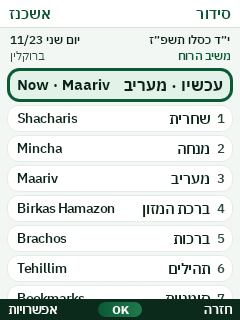
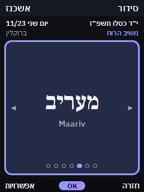
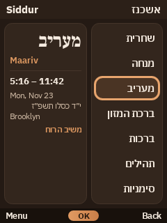
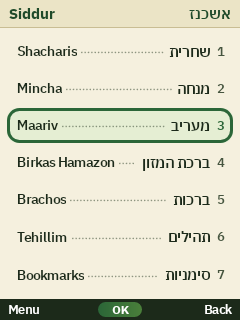
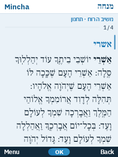
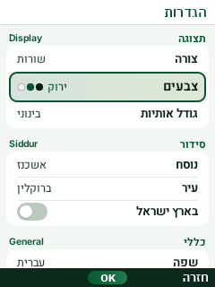
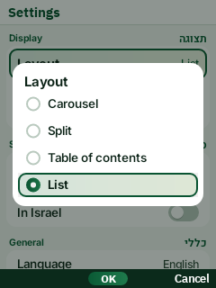
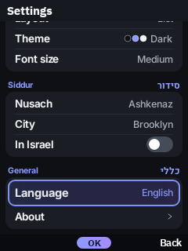
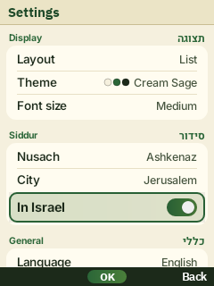
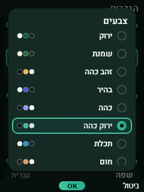

# PureFlip Siddur

A siddur for keypad flip phones, made for the TCL Flip 2 running PureFlip. It works fully with the D-pad and does not need a touch screen. Hebrew dates, zmanim, and what is said on each day come from [KosherJava Zmanim](https://github.com/KosherJava/zmanim).

There are no ads, and the app does not use the internet. It asks for no permissions.

This is version 0.2.0 (package `com.pureflip.siddur`). It runs on Android 5.0 and up, and it targets Android 11.

## Screenshots

Home, list (Forest):



Home, carousel:



Home, split (Coffee):



Home, contents (Cream):



A tefillah (Sky):



Settings, theme (Forest, Hebrew):



Settings, home layout:



Settings, language:



Settings, In Israel (Cream, English):



Settings, theme list (Teal):



## Features

- Shacharis, Mincha, Maariv, Birkas Hamazon, brachos, and Tehillim.
- Nusach Ashkenaz, Sefard, and Edot HaMizrach.
- The home screen opens on the tefillah for the current time.
- Parts that are not said today are folded. Press OK to open them. The top of the tefillah lists today's insertions.
- A progress bar and a section count show where you are. The menu jumps to any section.
- Tehillim by day of the month, day of the week, or by perek.
- Bookmarks: save your place from the menu, and open it again from the home screen.
- Zmanim for the city you pick. **In Israel** uses the calendar used in Israel.
- Four home layouts: carousel, split, contents, and list. Ten color themes and three text sizes.

## Phones and screens

Screens stay in portrait and are laid out for a small keypad phone, about 240×320 dp (a TCL Flip 2). The app is pure Java with no native code, so it runs on armeabi-v7a phones.

The bottom bar shows the soft keys. The left soft key is the menu, the middle is OK, and the right soft key is Back. While a pop-up is open, the right soft key reads Cancel.

## Keys

On the home screen:

- The **D-pad** moves between tefillos.
- **OK** opens the selected tefillah.
- **1** to **7** open an item directly.

Inside a tefillah:

- **Up** and **Down** move one paragraph. Hold the key to scroll smoothly.
- **Left** and **Right** jump to the next or previous section. The text runs right to left, so Left is forward.
- **8** and **2** move a page down or up.
- **OK** opens a folded part, or moves a page down.
- The **left soft key** opens the menu: Sections, Add bookmark, Text size, and Back to start.

In every list and pop-up, **Up** and **Down** move, **OK** picks, and **1** to **9** pick an item directly.

## Languages

- **English.** Menus, settings, and soft-key labels are in English.
- **Hebrew.** Menus, settings, and soft-key labels are in Hebrew, and the app reads right to left.

The tefillos stay in Hebrew in both languages.

## Building

You need JDK 17 and the Android SDK, with platform 34 and build-tools 34.0.0.

```sh
./gradlew :app:testReleaseUnitTest   # tests (JUnit and Robolectric)
./gradlew :app:assembleRelease       # unsigned APK in app/build/outputs/apk/release/
```

Sign the APK with your own key: run zipalign, then `apksigner sign`. No keys are kept in this repository.

## Credits

Texts:

- Ashkenaz and Sefard weekday tefillos and Birkas Hamazon: The Metsudah Siddur, 1981 (Avrohom Davis), via [Sefaria](https://www.sefaria.org/Siddur_Ashkenaz) ([CC BY 3.0](https://creativecommons.org/licenses/by/3.0/)).
- Ashkenaz brachos: [Daat Siddur Ashkenaz](https://www.daat.ac.il/daat/sidurim/tohen3.htm) (public domain).
- Sefard brachos: [Torat Emet 357](http://www.toratemetfreeware.com/index.html?downloads) (public domain).
- Edot HaMizrach: [Siddur Edot HaMizrach, Shaliehsaboo Edition](https://www.sefaria.org/Siddur_Edot_HaMizrach) ([CC0](https://creativecommons.org/publicdomain/zero/1.0/)).
- Tehillim: [Tanach with Nikkud](https://tanach.us) (public domain).

Libraries:

- [KosherJava Zmanim](https://github.com/KosherJava/zmanim) 3.0.0 (LGPL 2.1).
- [desugar_jdk_libs](https://github.com/google/desugar_jdk_libs) 2.1.5 (GPL 2.0 with the Classpath Exception).

Fonts, all under the SIL Open Font License 1.1:

- [Frank Ruhl Libre](https://github.com/fontef/frankruhllibre).
- [IBM Plex Sans Hebrew](https://github.com/IBM/plex).
- [Inter](https://github.com/rsms/inter), included as a subset.
- [Heebo](https://github.com/OdedEzer/heebo), included as a subset.

## License

Copyright (C) 2026 Yidtech-101.

This app's own code is GPL-2.0-only with an exception for Apache-2.0 libraries. The full text and the exception are in `LICENSE`.

The bundled texts, fonts, and libraries keep their own licenses, as listed in `THIRD_PARTY_LICENSES.md` and `licenses/`.
